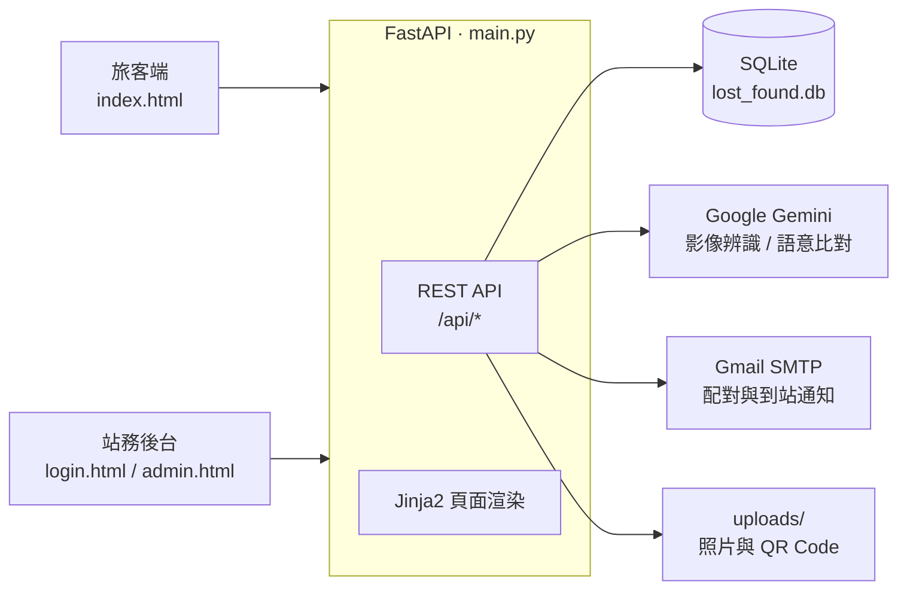
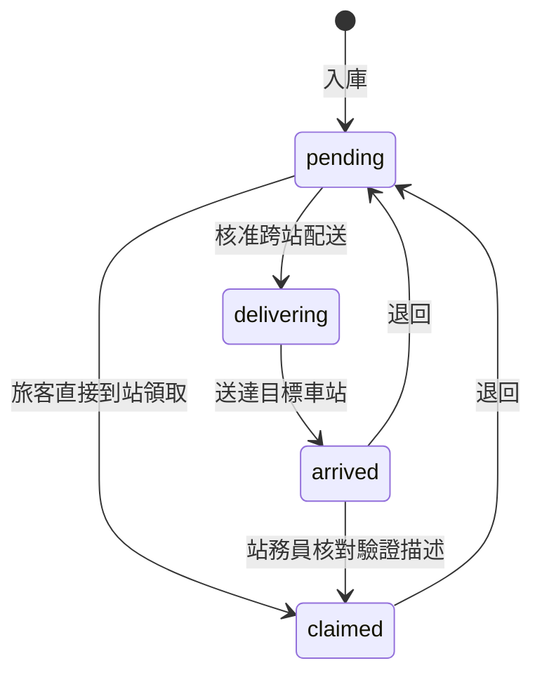

# 🚆 鐵道尋蹤 HACKRAIL — 鐵路遺失物管理系統

一套給台鐵站務人員與旅客使用的遺失物登錄、協尋與跨站配送系統。後端用 FastAPI + SQLite，整合 Google Gemini 做照片辨識與語意比對，並用 QR Code 追蹤物品流向。

- **旅客**：瀏覽公開清冊、用照片找東西、登記「許願池」等系統通知、申請把物品配送到指定車站
- **站務人員**：用 AI 輔助登錄遺失物、管理配送與領取核對、掃 QR Code 更新物品位置

> 完整的資料模型、狀態機與 API 說明見 [SYSTEM_OVERVIEW.md](SYSTEM_OVERVIEW.md)；上台展示流程見 [demo_script.md](demo_script.md)。

---

## ✨ 功能亮點

| 功能 | 說明 |
|---|---|
| 🤖 AI 輔助登錄 | 上傳照片，Gemini Vision 自動建議分類、標籤、顏色、描述，並 OCR 證件末四碼（自動標為敏感物品、遮蔽顯示） |
| 🔍 以圖找圖 | 旅客上傳照片，萃取特徵關鍵字後比對資料庫，依信心分數分成「高度符合／可能相關」 |
| 🌟 許願池協尋 | 登記特徵關鍵字後，之後每有新物品入庫就自動比對（關鍵字 + AI 語意，例如「水壺」≈「保溫杯」），配對成功寄 Email 通知 |
| 📦 跨站配送 | 旅客指定領取車站，站務端追蹤 pending → delivering → arrived；到站後必須核對旅客的「驗證描述」才能結案 |
| 🏷️ QR Code 流向追蹤 | 每件物品都有專屬 QR Code，掃描即更新所在車站，並留下完整移動時間軸 |
| 📊 AI 修正率統計 | 記錄站務員修改了哪些 AI 建議，依「分類 × 欄位」計算修正率；修正率過高的欄位會在登錄表單上主動提醒 |
| 🔒 個資保護 | 敏感物品要點擊才顯示明碼，每次查看都留紀錄；已領回物品預設不出現在公開清冊 |

---

## 🏗️ 系統架構



物品狀態流程：



退回 `pending` 時，系統會重新比對許願池並通知等待中的旅客。

---

## 🧰 技術棧

- **後端**：Python、FastAPI、SQLAlchemy、Jinja2
- **資料庫**：SQLite
- **前端**：HTML + Tailwind CSS（預編譯）
- **AI**：Google Gemini（`gemini-flash-latest`）
- **其他**：qrcode、Pillow、Gmail SMTP

---

## 🚀 快速開始

### 1. 安裝依賴

```bash
pip install fastapi uvicorn sqlalchemy jinja2 python-multipart google-generativeai pillow qrcode python-dotenv
```

### 2. 設定環境變數

```bash
cp .env.example .env
```

| 變數 | 用途 | 沒設定時 |
|---|---|---|
| `GEMINI_API_KEY` | AI 辨識、以圖找圖、語意比對 | AI 功能回傳錯誤或降級為純關鍵字比對 |
| `GMAIL_ACCOUNT` / `GMAIL_APP_PASSWORD` | 寄送通知信（需 Google「應用程式密碼」） | 靜默跳過寄信 |
| `SITE_URL` | 通知信中照片連結的網址 | 預設 `http://127.0.0.1:8000` |

### 3. 編譯樣式（第一次，或改過 HTML 的 Tailwind class 時）

```bash
npm install
npm run build:css
```

### 4. 啟動

```bash
python -m uvicorn main:app --host 127.0.0.1 --port 8000
```

- 旅客端：http://127.0.0.1:8000/
- 站務後台：http://127.0.0.1:8000/admin（示範帳密 `admin` / `admin123`）

repo 已附帶示範資料（`lost_found.db` 約 21 筆遺失物與 `uploads/` 照片），clone 下來就能直接瀏覽。想從空白資料庫開始，刪除 `lost_found.db` 後重啟即可，資料表會自動建立。

> ⚠️ 預設帳密只適合本機展示，正式部署前務必更換。

---

## 📁 專案結構

```text
.
├─ main.py                 # FastAPI 主程式（路由、資料模型、AI 與寄信邏輯）
├─ index.html              # 旅客端頁面
├─ login.html / admin.html # 站務登入與後台
├─ modals.html             # 後台彈出視窗的 HTML 片段（新增物品等）
├─ static/                 # Tailwind CSS、車站資料 stations.js、favicon
├─ uploads/                # 物品照片與 QR Code
├─ lost_found.db           # SQLite 示範資料庫
├─ scrape_tra.py           # 爬取台鐵遺失物公告
├─ fetch_stations.py       # 下載台鐵車站清單產生 static/stations.js
├─ tailwind.config.js / package.json
├─ SYSTEM_OVERVIEW.md      # 完整系統說明（資料模型、狀態機、API）
└─ demo_script.md          # 上台展示腳本
```

---

## 📚 文件

- [SYSTEM_OVERVIEW.md](SYSTEM_OVERVIEW.md)：系統架構、資料模型、狀態機、全部 API 路由
- [demo_script.md](demo_script.md)、[demo_video_1.md](demo_video_1.md)、[demo_video_2.md](demo_video_2.md)：展示與錄影腳本
- [鐵道尋蹤_系統優化建議.md](鐵道尋蹤_系統優化建議.md)：後續優化方向
